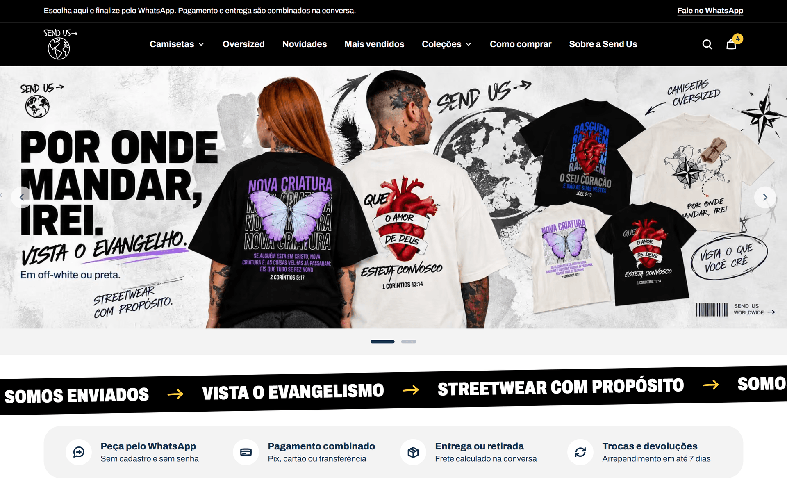
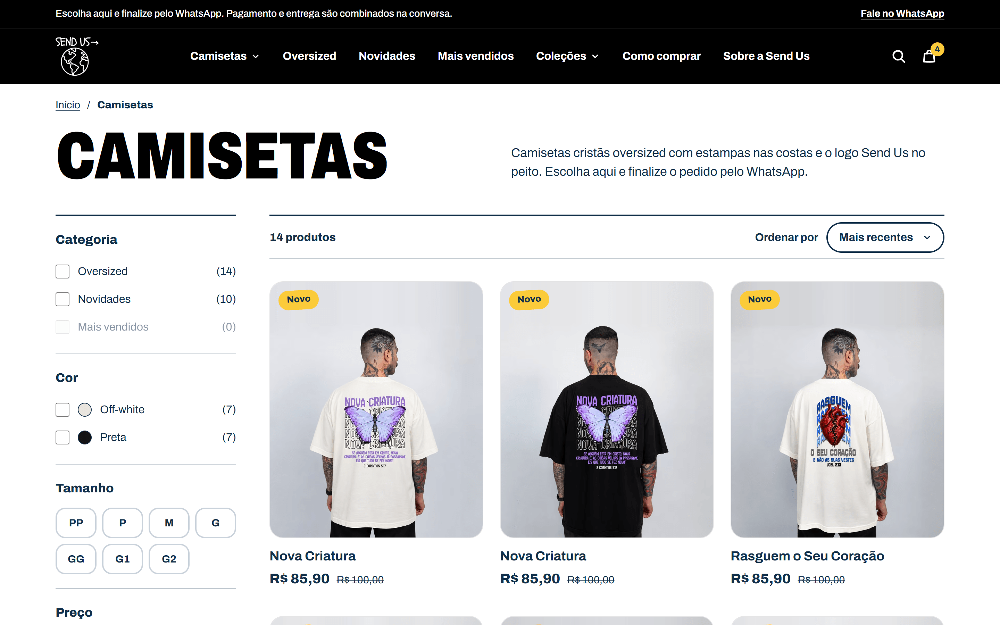
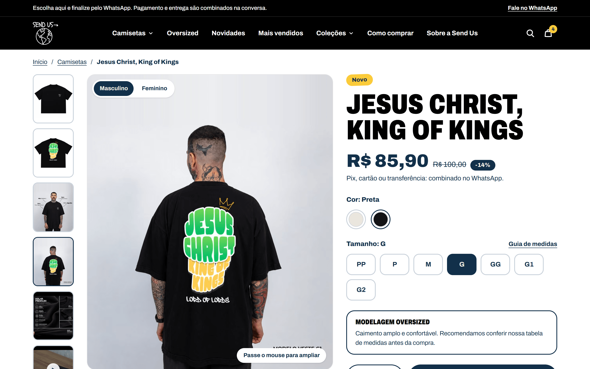
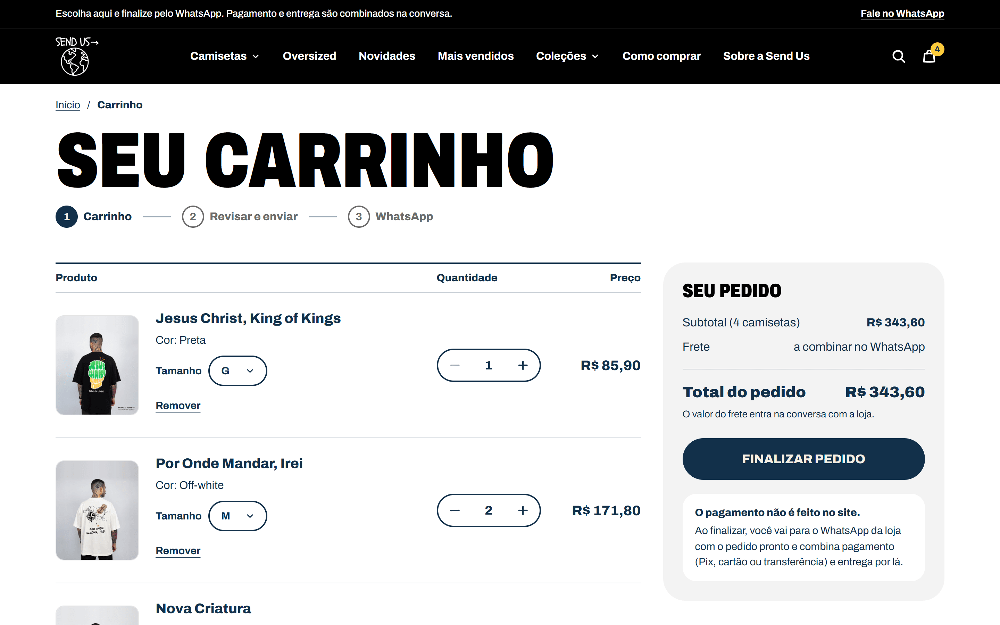
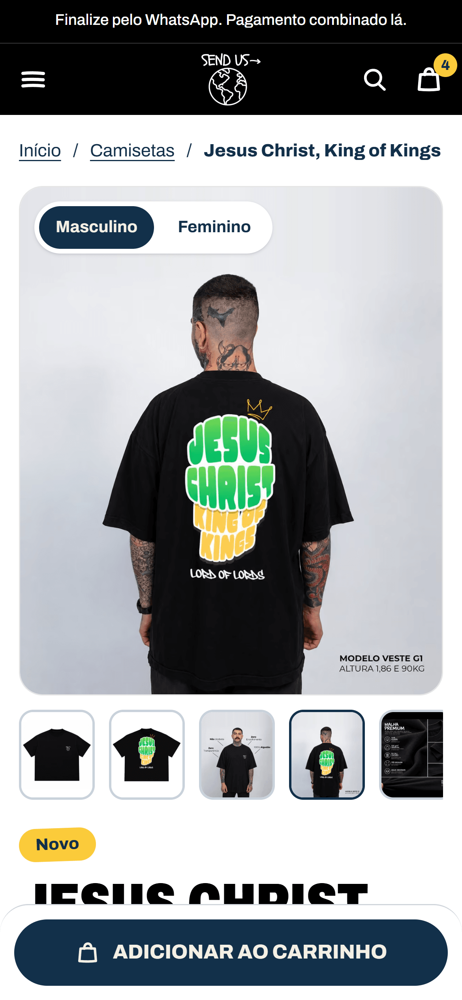
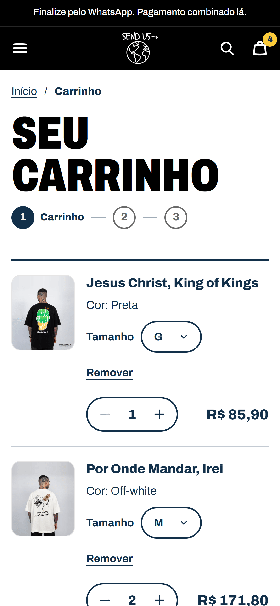

# Send Us

Loja online de camisetas cristãs oversized, com carrinho próprio e pedidos finalizados pelo WhatsApp.
Sem checkout de pagamento: o cliente monta o pedido no site e a conversa com a loja combina pagamento e entrega.

**Site:** [sendus.com.br](https://sendus.com.br)

## Telas

### Desktop

<table>
  <tr>
    <th>Catálogo</th>
    <th>Produto</th>
    <th>Carrinho</th>
  </tr>
  <tr>
    <td></td>
    <td></td>
    <td></td>
  </tr>
</table>

### Mobile

<table>
  <tr>
    <th>Home</th>
    <th>Produto</th>
    <th>Carrinho</th>
  </tr>
  <tr>
    <td></td>
    <td></td>
    <td></td>
  </tr>
</table>

## Funcionalidades

- **Home:** carrossel de banners (com arte própria para celular), seleção de camisetas, categorias e passo a passo de compra.
- **Catálogo:** uma entrada por estampa e cor, com filtros por categoria, cor, tamanho e faixa de preço, ordenação (mais recentes, mais vendidos, menor e maior preço) e busca por texto. Os filtros ficam na URL, então qualquer busca pode ser compartilhada. No celular, os filtros abrem em tela cheia.
- **Produto:** galeria com camiseta de frente e de costas, modelos masculino e feminino, detalhe da malha e vídeo; zoom ao passar o mouse no desktop; escolha de cor e de tamanho (PP a G2, com indicação de esgotado); guia de medidas; barra de compra fixa no celular; sugestões de outras camisetas.
- **Carrinho:** carrinho lateral que abre ao adicionar e página de carrinho com troca de tamanho, quantidade (1 a 10), remoção com "Desfazer" e subtotal.
- **Finalização via WhatsApp:** modal de revisão com nome e cidade opcionais; o pedido sai como mensagem pronta para a conversa da loja. Se o navegador bloquear a nova aba, o modal oferece o link e o botão "Copiar mensagem".
- **Busca** em modal, acessível de qualquer página pelo cabeçalho, com atalhos para categorias.
- **Páginas institucionais:** sobre, tabela de medidas, entrega e frete, trocas e devoluções, contato, privacidade e termos de uso.
- **SEO e acessibilidade:** `title`, descrição e canonical por página, Open Graph, `sitemap.xml`, `robots.txt` e dados estruturados; link "Pular para o conteúdo", modais com `<dialog>` nativo e respeito a `prefers-reduced-motion`.

## Stack

| Camada | Tecnologia |
|---|---|
| Framework | Next.js 16.3 (App Router) |
| UI | React 19.2 |
| Linguagem | TypeScript 5 |
| Estilo | Tailwind CSS 4 |
| Fontes | `next/font` (Archivo e Just Another Hand) |
| Testes | Vitest 5 + jsdom |
| Lint | ESLint 9 |

Sem backend e sem banco de dados: o catálogo é local e as telas o leem por uma camada de serviço assíncrona.

## Decisões técnicas

- **Páginas estáticas.** Produtos e páginas institucionais são geradas no build (`generateStaticParams` com `dynamicParams = false`). O catálogo passa por um repositório assíncrono (`getProducts` / `getProductBySlug`), então trocar os dados locais por uma API não exige mexer nas telas.
- **Carrinho como estado externo.** As regras ficam num reducer puro, ligado a uma store lida com `useSyncExternalStore` e persistida no `localStorage` com chave versionada. Ao carregar, o carrinho salvo é cruzado com o catálogo: o preço vem sempre do catálogo, e itens que sumiram ou esgotaram saem com aviso. Abas abertas se sincronizam pelo evento `storage`, e dado corrompido vira carrinho vazio em vez de erro.
- **Mensagem do WhatsApp como função pura.** `buildWhatsAppMessage` monta o texto do pedido (itens, tamanho, cor, quantidade, valor e subtotal) e o link `wa.me` codifica o resultado. O checkout fica atrás de uma interface (`CheckoutProvider`), de modo que um provider de pagamento online poderia entrar sem alterar o carrinho. Reducer, persistência, store, mensagem, filtros e formatação de preço têm testes em Vitest.
- **Filtros do catálogo na URL.** A leitura dos parâmetros ignora valores desconhecidos em vez de quebrar a página, e `/loja?cor=preta&tamanho=M&ordem=menor` abre já filtrado.
- **SEO técnico e imagens.** Metadados e canonical por página, `sitemap.xml` gerado a partir do catálogo, `robots.txt`, JSON-LD `Product` nas páginas de produto e `ItemList` na listagem. Imagens pelo `next/image` em AVIF e WebP, e preços guardados em centavos para evitar erro de arredondamento.

---

> Projeto comercial desenvolvido para cliente. O código-fonte é privado; esta página apresenta o projeto e as decisões técnicas.

**Luíz Felipe Lopes da Silva** · [LinkedIn](https://linkedin.com/in/luizlsilva)
